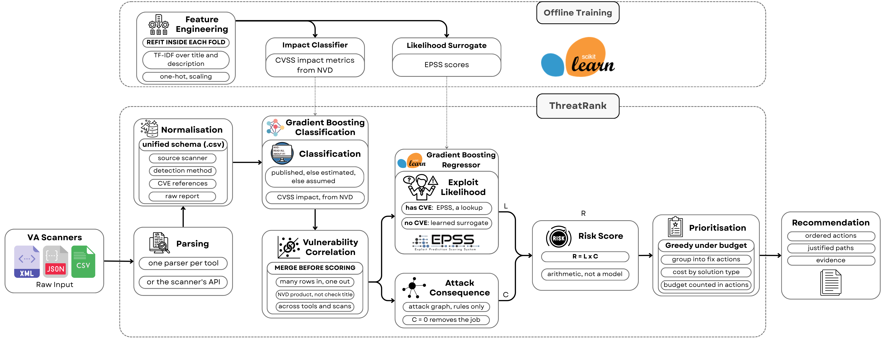

# ThreatRank

**Machine learning-based risk prediction and prioritization for vulnerability assessment reports.**

Vulnerability scanners report hundreds of findings per network and sort them by CVSS severity.
ThreatRank sits above the scanners. It merges their reports, scores every finding along two axes,
and turns the result into a short, ordered list of remediation actions that fits a budget:

- **Exploit likelihood (L):** the published EPSS score when the finding cites a CVE that has one,
  and a learned surrogate model otherwise. Findings with no CVE (default credentials, end-of-life
  software, weak TLS) therefore receive a value instead of being dropped.
- **Attack consequence (C):** whether the finding lies on a path to a declared security goal in an
  attack graph built by [MulVAL](https://github.com/risksense/mulval) from the findings and the
  network topology. Work that cannot reach the goal receives no priority.
- **Risk** `R = L x C`. Findings are grouped into actions (one upgrade or configuration change that
  closes several findings), and actions are chosen greedily by risk per unit of cost.

The method is evaluated on a laboratory of 14 containers scanned by OpenVAS, Nessus and Qualys,
against CISA's Known Exploited Vulnerabilities (KEV) catalogue as the external label.

The accompanying paper, *ThreatRank: Machine Learning-Based Risk Prediction and Prioritization for
Vulnerability Assessment Reports*, has been accepted at IEEE ISPA 2026. It is submitted separately
as the final report.



## Team

CSS453 senior project, Sirindhorn International Institute of Technology, Thammasat University.
Advisor: Somchart Fugkeaw (somchart@siit.tu.ac.th).

| Student ID | Name | GitHub |
|---|---|---|
| 6622782223 | Chaiyapat Anantarasuchart | [@erthcyp](https://github.com/erthcyp) |
| 6622770665 | Proud Pitugkittikul | [@ProudP](https://github.com/ProudP) |
| 6622770509 | Benyapa Tawunwoot | [@benyapaben](https://github.com/benyapaben) |

## Repository layout

```
reproduce.sh            reruns the pipeline and regenerates every result (see "Run")
tests/check_results.py  compares a run's results with the recorded ones (see "Test")
requirements.txt        pinned Python dependencies
Dockerfile              the exact environment the recorded results were produced in

data/
  raw/                  the scanners' original reports (OpenVAS XML, Nessus JSON, Qualys XML)
  evidence/             package listings captured on the hosts at scan time
  processed/            normalised findings, one CSV per scan, parsed from data/raw/
  *.py                  the pipeline: parsers, likelihood, impact, attack-graph consequence,
                        prioritisation, experiments and figures (one script per stage)
  cwe_map.json          NVD records for the CVEs the corpus cites (snapshot)
  epss_scores-*.csv.gz  the EPSS snapshot every likelihood value uses
  kev_catalog.json      CISA KEV, catalogVersion 2026.08.17; the label, never a feature
  topology_*.json       the declared network topology and security goal for the attack graph
  figures/              every figure and table, as generated
  scans.md              the laboratory notebook: every scan, its settings and its results
mulval/
  cases/lab3/           attack-graph input and the MulVAL output the experiments read
  cases/lab3_check/     the graph rebuilt with impact values from the classifier
  cases/lab4/           the three-host chain that was exploited live to validate the graph
  setup.sh, README.md   how to install MulVAL and rebuild the graph (optional)
notebook/
  ThreatRank.ipynb      end-to-end exploratory notebook (Google Colab); not needed to reproduce
docs/
  architecture.png      the system diagram above
```

Nothing is fetched from the network when the pipeline runs. The scanner reports, the EPSS, NVD
and KEV snapshots and the attack-graph output are all pinned in the repository, so a run today
gives the same numbers as the recorded one.

## Install

Requires **Python 3.12** and about 100 MB of disk. Tested on Ubuntu 24.04; any OS with Python 3.12
works.

```bash
git clone https://github.com/erthcyp/ThreatRank.git
cd ThreatRank
python3 -m venv .venv
source .venv/bin/activate          # Windows: .venv\Scripts\activate
pip install -r requirements.txt
```

The versions in `requirements.txt` are pinned on purpose. The learned models are sensitive to the
scikit-learn version: a different version produces Spearman correlations that differ by about
0.02, so `tests/check_results.py` would report a mismatch.

Optional: `sudo apt install fonts-liberation` makes the generated figures pixel-identical to the
recorded ones. Without it the numbers are the same, only the font differs.

**Alternatively, use Docker**, which needs nothing else installed:

```bash
docker build -t threatrank .
docker run --rm -v "$PWD":/work threatrank ./reproduce.sh
docker run --rm -v "$PWD":/work threatrank python3 tests/check_results.py
```

## Run

```bash
./reproduce.sh quick     # about 1 minute
./reproduce.sh           # about 20 minutes
```

`quick` parses the raw scanner reports and checks that the parsers reproduce the committed CSVs
byte for byte, builds the remediation plan, and regenerates the three tables. The full run adds
the learned models, the sensitivity analysis and the figures. Each step prints `ok` or `FAIL`
with its running time. Results are written over the copies in `data/figures/`.

## Test

```bash
python3 tests/check_results.py            # after ./reproduce.sh
python3 tests/check_results.py --quick    # after ./reproduce.sh quick
```

This compares every number the run wrote with the recorded results in `tests/expected/`, allowing
a difference of 0.005, and exits with status 0 when everything matches:

```
ok    figures/tab_corpus.tex
ok    figures/tab_graphrank.tex
...
Every compared result matches the recorded run.
```

## The experiments one by one

Each script can also be run on its own from `data/`, and prints its result with the baseline it
must beat. Run them from the `data/` directory.

### 1. Parsing and normalising scanner output

```bash
python3 parse_openvas.py raw/openvas/2026-09-08_openvas_B_group-b-old-images.xml --offline -o out.csv
python3 fetch_nessus.py --from-raw raw/nessus/2026-09-29_nessus_B_group-b-nessus.json --group B --offline -o out.csv
python3 parse_qualys.py raw/qualys/2026-10-06_qualys_lab3.xml --group b2 -o out.csv
```

Each parser turns one scanner's report into the shared finding schema (one row per finding, with
host, port, check name, CVSS score, CVEs and KEV membership). `reproduce.sh` checks that the
output is identical to the committed CSV in `data/processed/`.

### 2. The remediation plan (Experiment 1)

```bash
python3 prioritise.py --graph ../mulval/cases/lab3/out --topology topology_lab3.json \
    --findings processed/findings_openvas_b2.csv \
    --findings processed/findings_nessus_b2.csv --correlate -o processed/plan_merged.csv
```

Merges both scanners, groups findings into actions by the product NVD names, and prints how much
exposure and how many KEV findings each ordering closes at budgets from 1% to 100%. The ordered
plan, with the reason for each action's rank, is written to `processed/plan_merged.csv`.

### 3. Prioritisation under a budget (Experiment 3)

Produced by `make_figures.py` (`figures/fig1_budget_risk.pdf`, `fig2_budget_kev.pdf`, and the
tables in `figures/tables.md`). On the attack-graph corpus (229 findings on three hosts):

| At a 5% budget | Exposure removed | KEV findings closed (of 7) |
|---|---|---|
| ThreatRank (`R = L x C`) | 58% | 5 |
| EPSS | 55% | 7 |
| SSVC / VMC | 55% | 7 |
| Severity, grouped into actions | 34% | 4 |

ThreatRank spends no budget on the 17 cost units of work that cannot reach the goal until the
whole list is exhausted. `graph_rank_table.py` compares it with ranking by attack-graph centrality
(`figures/tab_graphrank.tex`).

### 4. The learned components (Experiment 2)

```bash
python3 likelihood.py     # exploit-likelihood surrogate, about 3 minutes
python3 impact.py         # CVSS impact classifier, about 6 minutes
python3 transfer.py       # does the surrogate survive the shift to findings without a CVE?
```

| Result | Recorded value |
|---|---|
| Surrogate vs published EPSS, split grouped by CVE (Spearman) | 0.59, against 0.44 for scanner severity |
| Surrogate on the quarter of findings most like those without a CVE | 0.64, against 0.69 for a random quarter |
| Impact classifier, macro-F1 over confidentiality / integrity / availability | 0.42 / 0.38 / 0.47, against a majority baseline of 0.15 to 0.16 |

### 5. Robustness to the scanner (Experiment 4)

```bash
python3 robustness_table.py --graph ../mulval/cases/lab3/out --topology topology_lab3.json \
    -o figures/tab_robustness.tex
```

Repeats the grading with each scanner's findings mapped onto the same attack graph. On Qualys,
sorting by the scanner's own severity reaches the first KEV finding at rank 33; ThreatRank
reaches it at rank 1.

### 6. Sensitivity of the plan to the surrogate

```bash
python3 sensitivity.py --graph ../mulval/cases/lab3/out --topology topology_lab3.json \
    --findings processed/findings_openvas_b2.csv
```

Replaces the surrogate's value for the 12 findings that have no EPSS score with alternatives
(median, severity, 0, 1, shuffled) and reports whether the plan changes. Median, zero and shuffled
values leave the plan unchanged up to a 10% budget; setting all twelve to 1 moves one action and
changes the KEV count at 5% from 5 to 7.

### Other scripts

The remaining scripts in `data/` are the intermediate stages and the experiments that were tried
and recorded in `data/scans.md`, including the ones that did not work (for example
`signal_check.py`, `cross_scanner.py`, `rank_objective.py`). Every script starts with a docstring
saying what it measures and how to run it; `python3 <script>.py --help` lists its options.

## What is not in this repository

| Item | Why | How to obtain it |
|---|---|---|
| The laboratory itself | 14 Docker containers from [Vulhub](https://github.com/vulhub/vulhub) and the scanners | `data/scans.md` records every scan; only the reports are needed to reproduce |
| MulVAL and XSB | third-party tools with their own licences | `mulval/setup.sh`; only needed to rebuild the graph, whose output is committed |
| API keys (NVD, VulnCheck) | credentials | only needed to refresh the label snapshots with `fetch_labels.py` |
| `nvd_bulk.json`, `processed/nvt_corpus.csv` | 247 MB and 67 MB training caches | rebuilt by `fetch_nvd_bulk.py` and `parse_nvt.py`; used only by `feed_likelihood.py`, whose result is committed |

## Notes on the data

- **CISA KEV is the label and is never used as a feature.** Using it as an input would leak the
  answer into the model.
- Every split used to evaluate a model groups findings by host or by CVE, never at random, because
  findings on one machine are strongly correlated.
- `severity` in the findings CSVs is the CVSS base score (0 to 10); the label column is `threat`
  (Log, Low, Medium, High, Critical). Rows whose `threat` is `Log` are service detections, not
  weaknesses, and are excluded from every measurement.
- The laboratory hosts use private Docker bridge addresses (172.18.0.0/16) on an isolated
  network; no external system was scanned.
