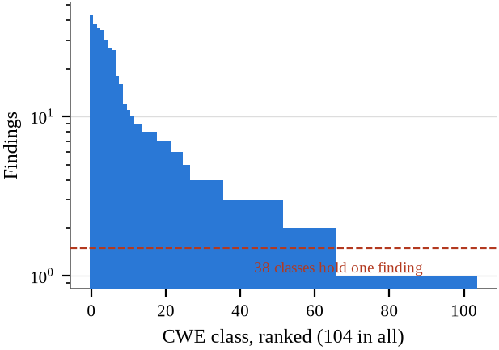
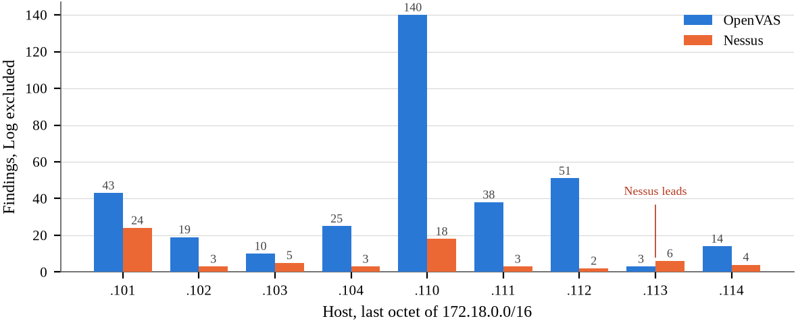
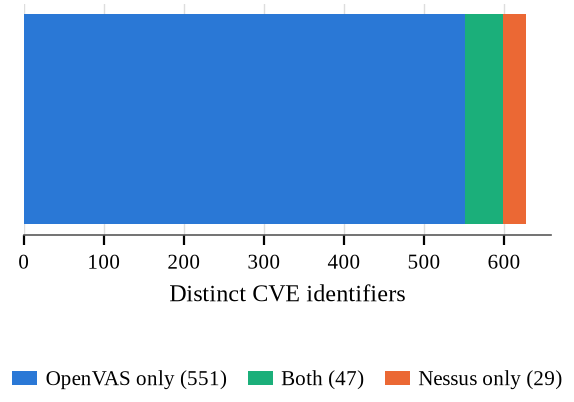
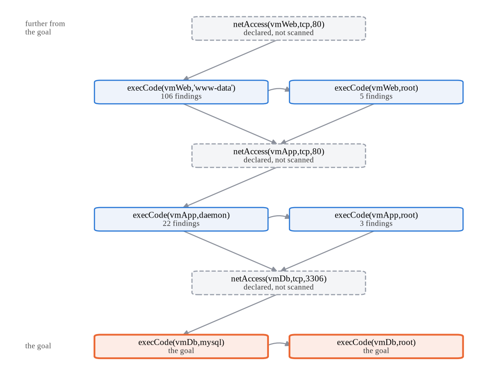
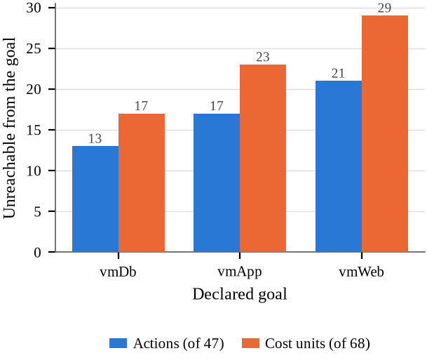
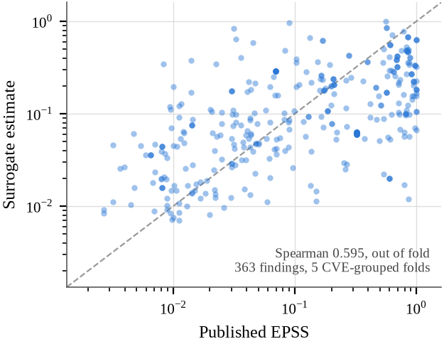
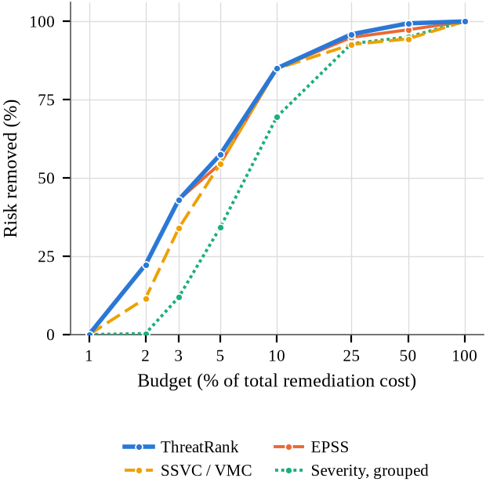
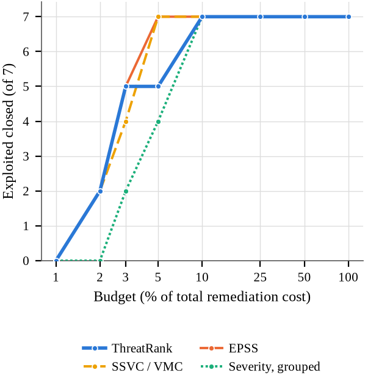
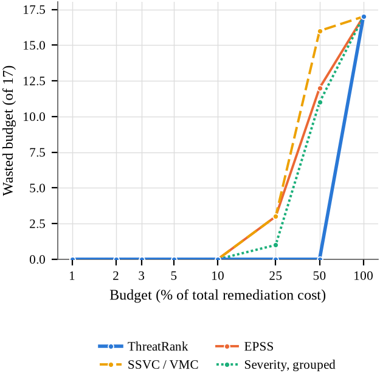
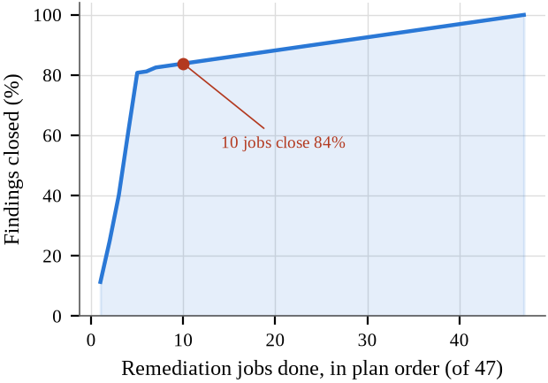

# ThreatRank results

Generated by `make_figures.py`. Do not edit this file; regenerate it. Figures sit beside it as PDF.

## Setup

### Corpus and cost model for the evaluated lab.

| Quantity | Value |
| --- | ---: |
| Findings, Log excluded | 229 |
| Hosts | 3 |
| Remediation actions | 47 |
| Findings per action | 4.87 |
| Actions, vendor patch | 35 |
| Actions, configuration | 9 |
| Actions, no fix available | 3 |
| Total cost, units | 68 |
| Known-exploited findings | 7 |
| Actions unreachable from the goal | 13 / 47 |

## Classification

### Why a learned weakness classifier was specified and then dropped.

| Quantity | Value |
| --- | ---: |
| Distinct CWE classes | 104 |
| Classes holding one finding | 38 |
| Largest class | 43 |
| Share in the largest class | 8% |

## Correlation

### Findings per host, both scanners, same day.

| Host | OpenVAS | Nessus |
| --- | ---: | ---: |
| 172.18.0.101 | 43 | 24 |
| 172.18.0.102 | 19 | 3 |
| 172.18.0.103 | 10 | 5 |
| 172.18.0.104 | 25 | 3 |
| 172.18.0.110 | 140 | 18 |
| 172.18.0.111 | 38 | 3 |
| 172.18.0.112 | 51 | 2 |
| 172.18.0.113 | 3 | 6 |
| 172.18.0.114 | 14 | 4 |

### CVE identifiers each scanner reported, and the overlap between them.

| Quantity | Value |
| --- | ---: |
| OpenVAS only | 551 |
| Reported by both | 47 |
| Nessus only | 29 |
| Overlap, Jaccard | 7.5% |

## Attack graph

### What MulVAL derived from the findings and the topology.

| Quantity | Value |
| --- | ---: |
| Vertices | 357 |
| Arcs | 676 |
| Input facts (LEAF) | 175 |
| Rule applications (AND) | 173 |
| Conclusions reached (OR) | 9 |
| Findings that reach the goal | 169 / 229 |

### Work that cannot reach the goal, for each thing an operator might defend.

| Declared goal | Unreachable actions | Cost units |
| --- | ---: | ---: |
| vmDb | 13 / 47 | 17 / 68 |
| vmApp | 17 / 47 | 23 / 68 |
| vmWeb | 21 / 47 | 29 / 68 |

## Likelihood

### The surrogate against published EPSS, cross-validated and grouped by CVE.

| Configuration | Spearman |
| --- | ---: |
| Surrogate, CVE-grouped split | 0.595 |
| Registered threshold | 0.30 |

### Does the surrogate survive the shift between the population it trains on and the one it serves? The random hold-out separates the cost of the shift from the cost of a smaller test set.

| Evaluation | Spearman | n |
| --- | ---: | ---: |
| CVE-grouped split, the headline | 0.595 | 363 |
| shifted hold-out, most CVE-like | 0.637 | 91 |
| random hold-out, same size | 0.690 | 91 |
| leave-one-family-out, 8 families | 0.469 | 363 |
| train high QoD, test low QoD | 0.673 | 44 |

## Prioritisation

### Risk removed, as a percentage of the total, against budget.

| Ordering | 1% | 2% | 3% | 5% | 10% | 25% | 50% | 100% |
| --- | ---: | ---: | ---: | ---: | ---: | ---: | ---: | ---: |
| ThreatRank | 0 | 22 | 43 | 58 | 85 | 96 | 99 | 100 |
| SSVC / VMC | 0 | 12 | 34 | 55 | 85 | 93 | 94 | 100 |
| EPSS | 0 | 22 | 43 | 55 | 85 | 95 | 97 | 100 |
| Severity, grouped | 0 | 0 | 12 | 34 | 70 | 93 | 95 | 100 |

### Known-exploited findings closed, of 7.

| Ordering | 1% | 2% | 3% | 5% | 10% | 25% | 50% | 100% |
| --- | ---: | ---: | ---: | ---: | ---: | ---: | ---: | ---: |
| ThreatRank | 0 | 2 | 5 | 5 | 7 | 7 | 7 | 7 |
| SSVC / VMC | 0 | 2 | 4 | 7 | 7 | 7 | 7 | 7 |
| EPSS | 0 | 2 | 5 | 7 | 7 | 7 | 7 | 7 |
| Severity, grouped | 0 | 0 | 2 | 4 | 7 | 7 | 7 | 7 |

### Budget spent on actions that cannot reach the goal, of 17 units.

| Ordering | 1% | 2% | 3% | 5% | 10% | 25% | 50% | 100% |
| --- | ---: | ---: | ---: | ---: | ---: | ---: | ---: | ---: |
| ThreatRank | 0 | 0 | 0 | 0 | 0 | 0 | 0 | 17 |
| SSVC / VMC | 0 | 0 | 0 | 0 | 0 | 3 | 16 | 17 |
| EPSS | 0 | 0 | 0 | 0 | 0 | 3 | 12 | 17 |
| Severity, grouped | 0 | 0 | 0 | 0 | 0 | 1 | 11 | 17 |

## Remediation

### Share of the corpus closed after the first few jobs, in plan order.

| Jobs done | Findings closed |
| --- | ---: |
| 1 | 11% |
| 5 | 81% |
| 10 | 84% |
| 20 | 88% |

